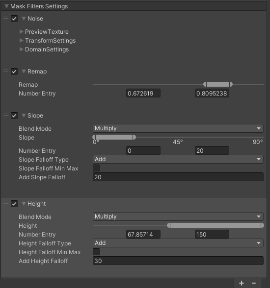
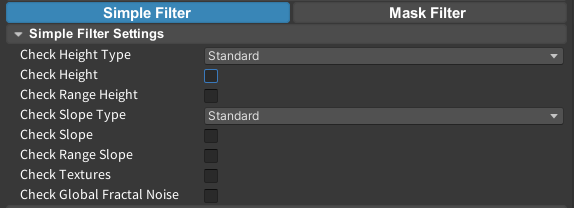
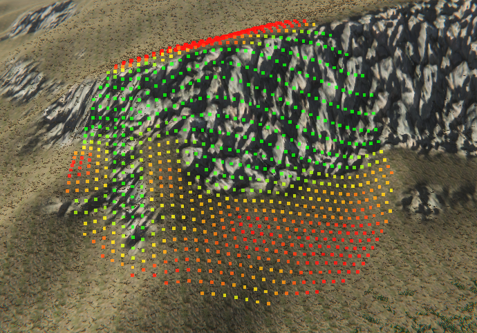
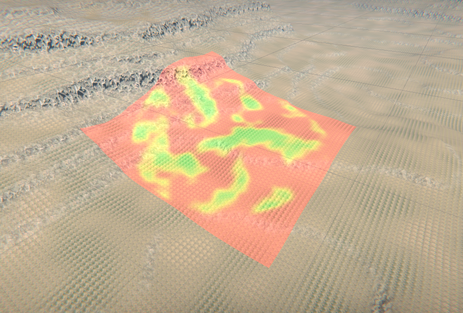

Mask Filters is an advanced system for defining where objects spawn. Each filter generates a grayscale mask over the terrain, and multiple filters can be stacked and blended together to create complex spawn rules.

Mask Filters work exclusively with **Unity Terrain** and are evaluated on the GPU, making them faster and more powerful than simple filters for terrain-based workflows. They support blending operations between filters (Multiply, Add) and include advanced filters like Aspect, Concavity, and Smooth that are not available in simple filters.

## How It Works

Each filter in the stack produces a mask (black = no spawn, white = spawn). Filters are applied in order:
- The **first filter** in the stack always starts fresh (Multiply mode is applied automatically).
- Every subsequent filter blends its result with the previous mask using the **Blend Mode** you set.

**Blend Modes:**
- **Multiply** — combines masks multiplicatively. The result can only be equal to or smaller than either input. Use this to narrow down the spawn area.
- **Add** — combines masks additively. The result can only be equal to or larger than either input. Use this to expand or union spawn areas.

## Simple filters vs mask filters

Filter Settings are split into two workflows:

- **Simple Filters** are lighter and work with any mesh, not only Unity Terrain.
- **Mask Filters** are terrain-focused, GPU-evaluated, and support blendable mask operations for more advanced control.

### Simple Filters

### Mask Filters

## Available Filters

<CardGroup cols={2}>
  <Card title="Height Filter" href="/megaworld/mask-filters/height-filter">
    Spawn within a defined height range with smooth falloff edges.
  </Card>
  <Card title="Height Noise Filter" href="/megaworld/mask-filters/height-noise-filter">
    Height filter with noise applied to the edges for a natural, irregular look.
  </Card>
  <Card title="Slope Filter" href="/megaworld/mask-filters/slope-filter">
    Spawn within a defined slope angle range.
  </Card>
  <Card title="Noise Filter" href="/megaworld/mask-filters/noise-filter">
    Add fractal noise to break up uniform spawn patterns.
  </Card>
  <Card title="Textures Filter" href="/megaworld/mask-filters/textures-filter">
    Restrict spawning to specific terrain texture layers.
  </Card>
  <Card title="Concavity Filter" href="/megaworld/mask-filters/concavity-filter">
    Target recessed or exposed terrain features like valleys and ridges.
  </Card>
  <Card title="Aspect Filter" href="/megaworld/mask-filters/aspect-filter">
    Target terrain faces pointing in a specific direction.
  </Card>
  <Card title="Smooth Filter" href="/megaworld/mask-filters/smooth-filter">
    Blur the current mask to soften hard edges.
  </Card>
  <Card title="Expand Filter" href="/megaworld/mask-filters/expand-filter">
    Dilate the current mask outward.
  </Card>
  <Card title="Expand Down Filter" href="/megaworld/mask-filters/expand-down-filter">
    Dilate the mask downward only, respecting terrain height.
  </Card>
  <Card title="Image Filter" href="/megaworld/mask-filters/image-filter">
    Use a custom texture as a mask.
  </Card>
  <Card title="Mask Operations Filter" href="/megaworld/mask-filters/mask-operations-filter">
    Apply mathematical operations to the current mask (invert, clamp, remap, etc.).
  </Card>
</CardGroup>

## Reading a mask without a scene capture

The Stamper MCP tool `megaworld_stamper_get_visualization` accepts a stamper `target`, an attached `groupPath` and a unique `prototypeName`. It evaluates that prototype's native GPU filter stack and returns one top-down grayscale PNG for each intersecting Terrain, plus full Area center/size in world units and each mask's world-space XZ rectangle. Image right is world +X; image up is +Z. The image uses the native Terrain mask resolution.

White means fitness 1; black means 0. `meanFitness` is the average mask weight and `nonzeroFraction` is the fraction above 0.001. With no enabled filters the stack is white. Inactive filters are skipped. This image contains raw filter fitness, not final spawn density: random opacity, failure rate, density and spawn-area falloff are separate. An inactive prototype can have a white mask and still produce no new instances.

Use this output to compare noise scale/offset and slope or blend settings before spawning. A scene capture remains useful for checking lighting, scale and the final visible distribution.

## Usage tips

Build and inspect a short stack before adding more filters: Noise → Remap → Slope (Multiply) is a useful vegetation starting point. Add height or texture restrictions only when the patch needs them.

Change one stage at a time and compare raw grayscale coverage on the same Area. A completely black result usually calls for checking thresholds or Multiply stages, not increasing density. An all-white result means the filters are not providing spatial variation. Keep a tuned species as a baseline and change other species' noise offsets or thresholds to avoid identical silhouettes.
