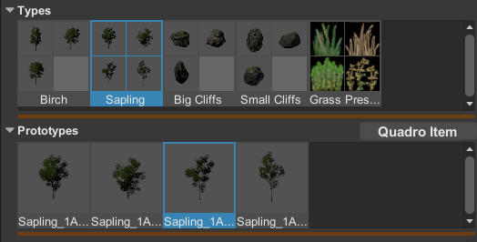
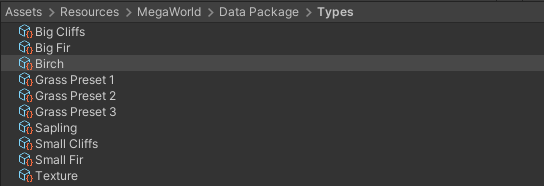
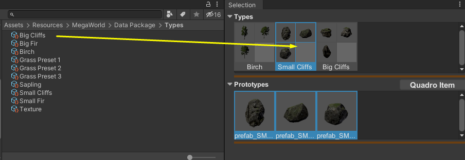
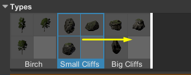
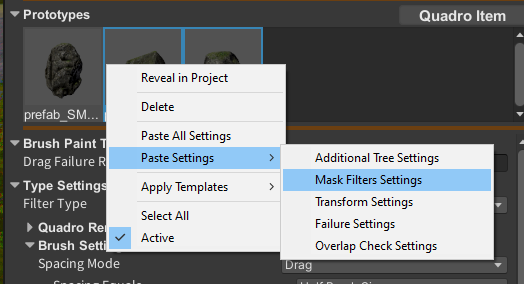
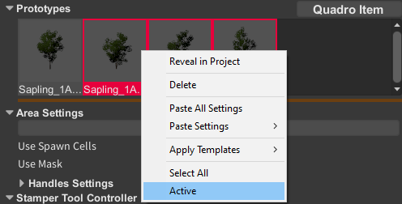

The Selection panel controls what the active tool works with.

In most workflows, this is where you choose the resource type and the specific prototypes that will be painted, stamped, modified, or erased.

## Main concepts

- **Type** is a reusable collection stored in the project. You can use types to organize similar prototypes, such as pines, rocks, or small trees.
- **Prototype** is the actual resource that MegaWorld uses in the scene.

## Common resource types

Depending on the tool, MegaWorld can work with:

- **Unity/GameObject**
- **Unity/Terrain Detail**
- **Unity/Terrain Texture**
- **Terrain Object** in workflows that expose terrain-object placement

## What you can do here

- Add prototypes to the current selection.
- Reorder types and prototypes.
- Copy and paste settings between selected items.
- Disable a prototype without removing it.
- Delete selected items from the selection set.

## Why ordering matters

In many MegaWorld workflows, order is not just visual. It can affect:

- which prototype wins selection more often;
- how you review and organize variations;
- how quickly you can tune groups of similar assets.

## Recommended workflow

1. Create or choose a type for the category you want to work on.
2. Add the prototypes you want in that type.
3. Disable weak variants instead of deleting them immediately.
4. Tune shared systems such as filters, transform components, and overlap checks on the selected prototypes.

## Groups, shared settings and isolation

A Group is a reusable asset containing prototypes and shared components. Add several Groups to a Stamper when species need independent settings and prototype collections. Each prototype still has its own density, failure rate and masks. One Group with default settings rarely gives useful control over a mixed vegetation layer.

**Copy All Settings** copies the component settings of the selected item. **Paste All Settings** replaces matching components on a compatible item; **Paste Settings** replaces only the named component, preserving the other settings. For example, paste Spawn Detail Settings to share density and failure rate while retaining the target species' own mask. The target retains its own prefab or texture asset. Nested filters and transforms are deep copied.

**Active** on a prototype controls whether it participates in subsequent spawns. Temporarily disable other prototypes to inspect one species, then restore them for the final mixture. Selection and Active are separate: selection chooses what an action edits. Disabling a prototype keeps its settings and does not erase previously spawned instances.

**Delete** removes a prototype from the Group, or a Group from the Stamper list. It does not delete the source prefab/texture asset or automatically remove existing Terrain resources and instances. Use Active for temporary comparisons.
